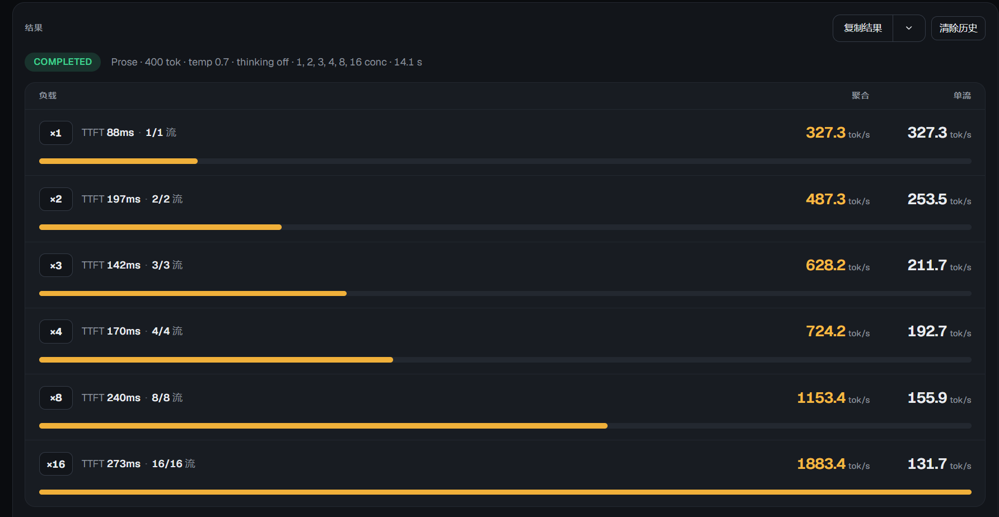
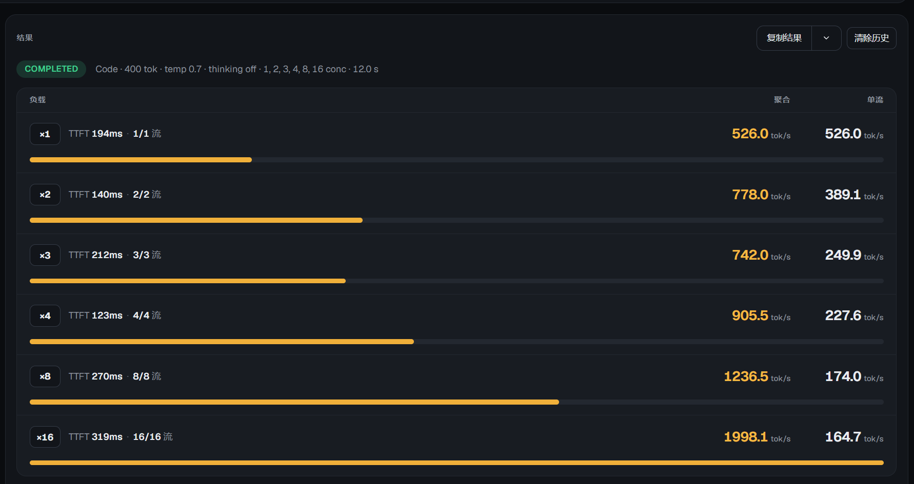
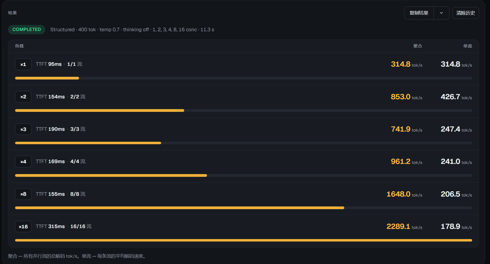
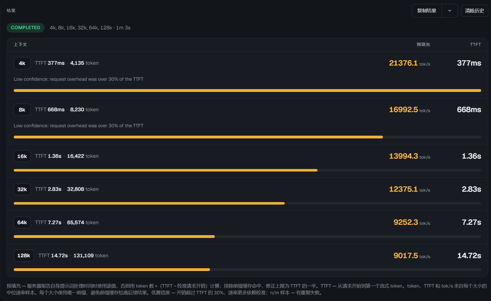

# 07 · SparkDash 独立复测（2026-11-20，temp 0.7）

> **English abstract** — An independent re-measurement of the same build with a different harness
> (SparkDash), a different workload (400 tokens, `temp 0.7`, thinking off) and a context sweep up to 128 K.
> It cross-validates the single-stream number (327.3 vs 325.6 tok/s, 0.5 % apart) and adds a prefill curve
> we could not measure before: **21 376 tok/s at 4 K → 9 018 tok/s at 128 K, TTFT 377 ms → 14.72 s.**
> It also retires one of the five open bugs (long prompts no longer crash).

这份数据不是我自己的 harness 出的，而是**另一个测量工具（SparkDash）在同一台机器、同一份构建上跑出来的**。
它之所以值得单独一页，是因为它同时做了两件事：**交叉验证**了单流数字，并首次给出了 **128 K 上下文曲线**。






---

## 1. 三个负载档（400 token、**temp 0.7**、thinking off）

### Prose（散文，14.1 s）

| 并发 | TTFB | 聚合 tok/s | 单流 tok/s |
|---|---|---|---|
| ×1 | 88 ms | **327.3** | 327.3 |
| ×2 | 197 ms | 487.3 | 253.5 |
| ×3 | 142 ms | 628.2 | 211.7 |
| ×4 | 170 ms | 724.2 | 192.7 |
| ×8 | 240 ms | 1153.4 | 155.9 |
| ×16 | 273 ms | **1883.4** | 131.7 |

### Code（代码，12.0 s）

| 并发 | TTFB | 聚合 tok/s | 单流 tok/s |
|---|---|---|---|
| ×1 | 194 ms | **526.0** | 526.0 |
| ×2 | 140 ms | 778.0 | 389.1 |
| ×3 | 212 ms | 742.0 | 249.9 |
| ×4 | 123 ms | 905.5 | 227.6 |
| ×8 | 270 ms | 1236.5 | 174.0 |
| ×16 | 319 ms | **1998.1** | 164.7 |

### Structured（结构化输出，11.3 s）

| 并发 | TTFB | 聚合 tok/s | 单流 tok/s |
|---|---|---|---|
| ×1 | 95 ms | **314.8** | 314.8 |
| ×2 | 154 ms | 853.0 | 426.7 |
| ×3 | 190 ms | 741.9 | 247.4 |
| ×4 | 169 ms | 961.2 | 241.0 |
| ×8 | 155 ms | 1648.0 | 206.5 |
| ×16 | 315 ms | **2289.1** | 178.9 |

---

## 2. 上下文扫描（prefill + TTFT，1 m 3 s）

| 上下文 | 实际 token | TTFT | prefill tok/s | 工具标注 |
|---|---|---|---|---|
| 4 K | 4 135 | **377 ms** | **21 376.1** | 低置信度（请求开销 > TTFT 的 30%） |
| 8 K | 8 230 | 668 ms | 16 992.5 | 低置信度（同上） |
| 16 K | 16 422 | 1.36 s | 13 994.3 | — |
| 32 K | 32 808 | 2.83 s | 12 375.1 | — |
| 64 K | 65 574 | 7.27 s | 9 252.3 | — |
| 128 K | 131 109 | **14.72 s** | **9 017.5** | — |

**读法**：prefill 从 4 K 的 21.4 k tok/s 衰减到 128 K 的 9.0 k tok/s（保留 42%）；
TTFT 在 32 K → 64 K 之间开始超线性（2.83 s → 7.27 s，2.57×），64 K → 128 K 是 2.02×。
128 K 仍能跑完，说明 `--context-length 262144` 这条路径**是通的**（见 §4 对旧 bug 的更正）。

---

## 3. 与 `docs/04` 的交叉验证（**只做点对点，不跨口径**）

| 指标 | `docs/04`（贪心 / 700 tok / 旧构建） | SparkDash（temp 0.7 / 400 tok / 现构建） | 差异怎么解释 |
|---|---|---|---|
| c1 散文单流 | 325.6（bf16 后） | **327.3** | **0.5% 内 —— 两个独立工具互相验证** |
| c1 代码单流 | 434.5（11-17） | **526.0** | 旧值是 bf16 之前 + 700 tok 题面；这是 +21%，与后续优化一致 |
| c16 聚合 | 2035.5（贪心） | 1883.4 / 1998.1 / **2289.1** | 三个负载档横跨旧值；结构化档高出 12% |
| c1 TTFB | 未记 | **88–194 ms** | 400 tok 短请求，prefill 占比低 |

**为什么 temp 0.7 反而比旧表的贪心数字高**：两者不是同一个东西。旧表的贪心数字是 **700 token 长题面 + 11-17 的构建**；
这张卡是 **400 token + 现构建（bf16 hyper-connection 等后续改动）**。采样确实会让接受率下降
（`docs/04` §1：贪心 0.79 → 采样 0.62），但构建本身的提升更大。
⇒ **不要拿这两张表相互换算**，只能各自纵向比。

**唯一的反常**：Code 与 Structured 的 ×2 → ×3 是**下降**的（778 → 742、853 → 742）。
这不是调度问题，是 400 token 的短请求 + 3 并发的**突发测量噪声**（每档只有一个 burst，没有取中位）。
⇒ 把 ×2/×3 看成 **±10% 的带**，不要当成"加并发变慢了"的结论。

---

## 4. 它顺带作废了 `docs/05` 的一条未解决项

`docs/05` C1 原来写的是：

> prompt ≥1024 token 时引擎崩（`hyper_prefill.mix` 的 RowWise `_scaled_mm` 在 SM120 不支持），修到第二层后回退。

**这张上下文扫描证明它已经不成立了**：4 K / 8 K / 16 K / 32 K / 64 K / 128 K 全部正常完成，
prefill 吞吐 21.4 k → 9.0 k tok/s。也就是说这条长 prompt 路径**在 11-19 之后被修好了**
（本仓库没有记录那次修复的细节 —— 如实标注为"已不再复现，根因修复未纳入本次交接"）。

`docs/05` C2（~50 K 长会话每轮全量重算、TTFT 30 s+）**不受影响**：那是**多轮会话的缓存命中**问题，
与这里的**单次长 prefill** 是两件事。本次扫描每条都是单轮、无前缀复用（工具也明说"每个大小使用唯一前缀，
避免前缀缓存抬高后续结果"）。

---

## 5. 复现

SparkDash 是独立工具，参数就是卡片抬头那一行：

```
Prose      : 400 tok · temp 0.7 · thinking off · 1,2,3,4,8,16 conc
Code       : 400 tok · temp 0.7 · thinking off · 1,2,3,4,8,16 conc
Structured : 400 tok · temp 0.7 · thinking off · 1,2,3,4,8,16 conc
Context    : 4k, 8k, 16k, 32k, 64k, 128k
```

用本仓库的 harness 跑等价口径（`bench/sweep.py` 是贪心、700 tok，与上面**不同**，请注意）：

```powershell
python bench\sweep.py 1,2,3,4,8,16 400   # 400 tok 三点负载（本仓库脚本是贪心，卡片是 temp 0.7）
python bench\prefill_ladder.py           # prefill 阶梯 4k→128k，TTFT 取首个流式 token，每档唯一前缀
python bench\ctx_speed.py                # 另一件事：解码速度 vs 上下文（2k/20k/60k/110k）
```

> 记录纪律：**任何一张卡都要带上 `temp`、`thinking`、`tokens`、以及并发列表。**
> 这张卡缺一个就会和 `docs/04` 的贪心表混为一谈 —— 而那正是本项目最大的方法论教训。
